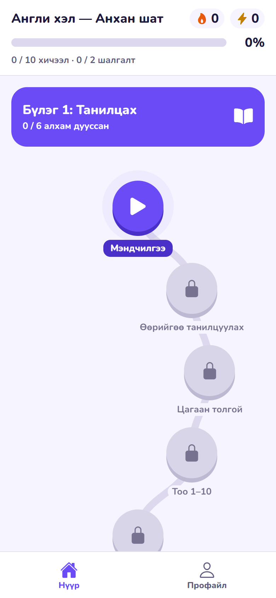
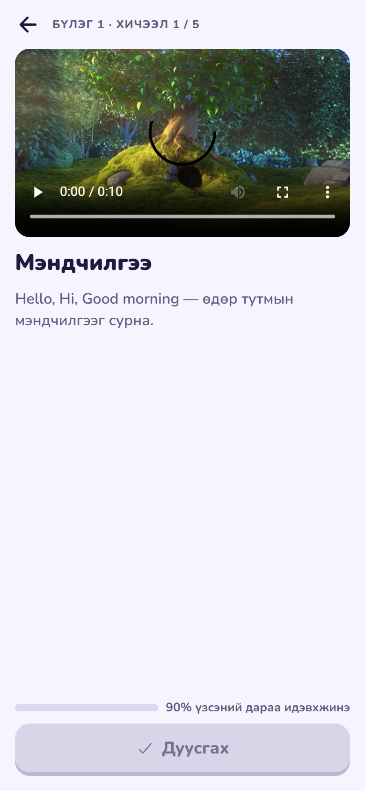
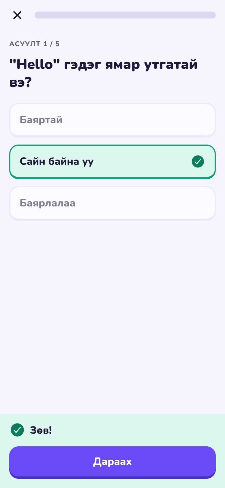
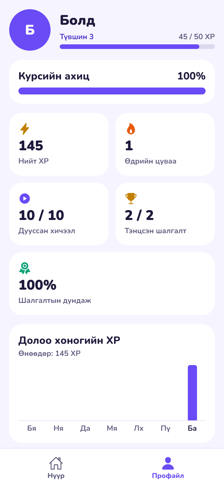

# OctoLearn — Video Course Mobile App (Prototype)

Fullstack хөгжүүлэгчийн сонгон шалгаруулалтын даалгавар. Хэрэглэгч зигзаг зам дээрх видео хичээлүүдийг дарааллаар нь нээж үзээд, бүлэг бүрийн төгсгөлд шалгалт өгч, XP цуглуулна.

| Хүргэх зүйл | Холбоос |
|---|---|
| Android APK | `[EAS Build-ийн холбоосоо энд оруулна]` |
| Демо видео (2:15, вэб хувилбар) | [docs/demo.webm](docs/demo.webm) |
| Дэлгэцийн зураг | [docs/screenshots/](docs/screenshots/) |

| Нүүр | Хичээл | Шалгалт | Профайл |
|---|---|---|---|
|  |  |  |  |

## Ажиллуулах заавар

Шаардлага: Node.js 20 эсвэл түүнээс дээш.

```bash
npm install
npx expo start        # QR кодыг Expo Go-оор уншуулна
npm run web           # эсвэл хөтөч дээр нээнэ
```

Expo Go нь SDK 58-ыг дэмждэг хамгийн сүүлийн хувилбар байх ёстой.

```bash
npm test              # unit тест
npm run typecheck     # TypeScript шалгалт
npm run lint          # ESLint
```

APK гаргах (Expo бүртгэл шаардлагатай, анхны удаа `npx eas-cli@latest login` хийнэ):

```bash
npx eas-cli@latest build --platform android --profile preview
```

Туршихдаа: Профайл → **Ахиц дахин эхлүүлэх** нь бүх ахицыг цэвэрлэнэ. Видео бүр 5–10 секунд тул хурдан давна.

## Технологи

- **Expo SDK 58, React Native, TypeScript** (strict)
- **Expo Router** — файлд суурилсан навигаци, bottom tab
- **Zustand + AsyncStorage** — төлөв ба төхөөрөмж дээрх хадгалалт
- **expo-video** — видео тоглуулагч
- **react-native-svg** — замын муруй шугам
- **Animated API** — бүх анимэйшн, нэмэлт сангүй
- **Jest (jest-expo)** — unit тест
- **Nunito** фонт — монгол `ө`, `ү` үсгийг агуулж байгааг файлаас нь шалгасан

Backend байхгүй. Контент [src/data/course.json](src/data/course.json) файлаас уншигдана.

## Архитектур

```
src/
  app/          Expo Router-ийн маршрутууд (нимгэн, түгжээний хамгаалалт энд)
  screens/      Дэлгэцүүд
  components/   Дахин ашиглах UI: зам, видео, график, цонх, товч
  domain/       Цэвэр логик: түгжээ, XP, шалгалт, streak, замын байршил
  store/        Zustand store, хадгалалт
  lib/          Жижиг туслах кодууд
  data/         course.json
  theme/        Өнгө, фонт, зайны токенууд
```

### Гол шийдвэрүүд

- **Бизнес логик React-аас тусдаа.** `domain/` нь `(хуучин төлөв, үйлдэл) → шинэ төлөв` хэлбэрийн цэвэр функцүүд тул дэлгэцгүйгээр тестлэгдэнэ. Store нь зөвхөн тэдгээрийг дуудаж хадгална. Backend нэмэхэд `domain/` өөрчлөгдөхгүй.
- **Статус хадгалагдахгүй, тооцоологдоно.** Цэгийн төлөв (дууссан / идэвхтэй / түгжээтэй) нь дууссан хичээлүүдээс гардаг: дуусаагүй эхний цэг нь идэвхтэй, үлдсэн нь түгжээтэй. Нийт XP болон streak ч `xpByDay`-аас гардаг. Хоёр эх сурвалж зөрөх боломжгүй.
- **Хадгалсан өгөгдөлд итгэхгүй.** Эвдэрсэн эсвэл хуучин формат аппыг унагаахгүй, зөвхөн зөв хэсгийг нь авна.
- **Шууд холбоос түгжээг давахгүй.** Вэб URL эсвэл deep link-ээр түгжээтэй хичээл рүү ороход нүүр рүү буцаана.
- **Системийн видео удирдлага.** Тоглуулах, гүйлгэх, бүтэн дэлгэцийг платформ бүрийн өөрийн удирдлагаар шийдсэн. Өөрөө бичвэл цаг их орох бөгөөд хэрэглэгчид ашиггүй.

### Даалгаварт тодорхойгүй байсан тул өөрөө шийдсэн зүйлс

| Асуудал | Шийдвэр | Шалтгаан |
|---|---|---|
| Прогресс бар хичээл, шалгалт хоёуланд шинэчлэгдэх ёстой | Хувийг 12 алхмаас (10 хичээл + 2 шалгалт) бодож, текстэд тусад нь харуулна: `5 / 10 хичээл · 0 / 2 шалгалт`, 42% | Зөвхөн хичээлээр бодвол шалгалт дуусахад бар хөдлөхгүй |
| Түгжээтэй 3-р бүлэг ахицад тоолох уу | Тоолохгүй | Хийж чадахгүй зүйлсээс болж 100%-д хүрэхгүй байх нь шударга бус |
| Видеог 90% хүртэл гүйлгэж болох уу | Болно: идэвхжих нь хүрсэн байрлалаар тооцогдоно | Шалгагчид туршихад хялбар. Бодит бүтээгдэхүүнд үзсэн хугацаагаар тоолох нь зөв |
| Шалгалт хэдэн XP өгөх | Хичээл 10 XP, тэнцсэн шалгалтын зөв хариулт бүр 5 XP. Тэнцээгүй бол 0 | Шалгалтын чанарыг урамшуулна |
| Дахин өгөхөд XP | Зөвхөн сайжирсан зөрүүг өгнө. Дахин үзсэн хичээл XP өгөхгүй | XP-г давталтаар хуримтлуулахаас сэргийлнэ |
| Дахин өгөөд унавал | Өмнөх тэнцсэн дүн, хамгийн сайн оноо хэвээр | Хэрэглэгчийн олсон ахицыг хасахгүй |
| Шалгалтын дундаж оноо | Өгсөн шалгалт бүрийн хамгийн сайн оноогоор | Дахин оролдсонд шийтгэхгүй |
| Түвшин | 50 XP тутамд нэг түвшин | Богино курс дээр өсөлт нь харагдана |
| Streak | XP авсан дараалсан өдрүүд. Өнөөдөр XP аваагүй ч өчигдрийнх хүртэл идэвхтэй | Өдрийн дундуур 0 болж харагдахгүй |
| Шалгалтын дундаас гарах | Баталгаажуулах цонх гарна, оролдлого хадгалагдахгүй | Санамсаргүй дарах эрсдэлийг бууруулна |
| Тэнцэх дүрэм | Санал болгосон 60%. Яг 60% бол тэнцэнэ | |

## Хийсэн ба хийгээгүй зүйлс

**P0 — бүгд хийгдсэн:** зигзаг зам ба бүлгүүд, цэгийн 3 төлөв, шалгалтын ялгаатай дүрс, түгжээний мэдэгдэл; прогресс бар ба XP; видео дэлгэц (90%-ийн дүрэм, +XP feedback, буцах); шалгалт (ахицын бар, зөв/буруу тэмдэглэгээ, үр дүн, дахин өгөх); профайл; bottom tab; төхөөрөмж дээрх хадгалалт.

**P1 — бүгд хийгдсэн:** идэвхтэй хичээл рүү автомат гүйлгэх; streak; анимэйшнтэй прогресс; бүтэн дэлгэц; түвшин; ахиц дахин эхлүүлэх.

**P2 — хийгдсэн:** вэб хувилбар; 27 unit тест; долоо хоногийн идэвхийн график; state management, давхаргатай бүтэц; streak ба түвшний логик; видеоны сүлжээний алдаа ба дахин оролдох.

**Хийгээгүй:** Node.js API + SQL, нэвтрэх хэсэг, Dark mode, Rive/Lottie, өдрийн зорилго, видеог офлайнаар татах. Цэвэр P0-д төвлөрсөн тул эдгээрийг орхисон.

### Туршилтын байдал

| Шалгалт | Үр дүн |
|---|---|
| Unit тест (`npm test`) | 27 / 27 амжилттай |
| TypeScript, ESLint, `expo-doctor` | Цэвэр |
| Android, iOS, вэб bundle (`expo export`) | Амжилттай |
| Бүрэн урсгал, Edge хөтөч дээрх production вэб build (Playwright, 60 шалгалт): түгжээ, видео тоглуулалт, XP, 60%-ийн хязгаар, хадгалалт, reset, видеоны алдаа ба сэргээх, эвдэрсэн хадгалалт, 320–820px дэлгэц | Амжилттай |
| **Бодит Android / iOS төхөөрөмж дээр** | `[Төхөөрөмж дээр туршсаныхаа дараа энд бичнэ]` |

### Мэдэгдэж байгаа хязгаарлалт

- Видеонууд нь хичээлийн агуулгатай холбоогүй, нээлттэй жишээ клипүүд (Big Buck Bunny, Jellyfish, Sintel, MDN flower).
- Видео тоглуулахад интернэт хэрэгтэй. Сүлжээгүй үед алдааны мэдэгдэл ба "Дахин оролдох" товч гарна.
- Хадгалагдсан хэрэглэгчийн нэр `course.json`-оос ирнэ. Нэр солих боломжгүй.
- Вэб хувилбарыг байршуулахад хостинг дээр SPA fallback (бүх замыг `index.html` рүү) тохируулах хэрэгтэй.

## Илүү цаг байсан бол

1. Node.js + PostgreSQL API: контент ба ахицыг серверт хадгалж, төхөөрөмж хооронд тааруулах.
2. Бодит үзсэн хугацааг тоолох: видеог гүйлгэж алгасахаас хамгаалах.
3. Офлайн горим: видео татах, ахицыг сүлжээ орж ирэхэд илгээх.
4. Хичээлийн дараах богино дасгал, өдрийн зорилго, мэдэгдэл.
5. Detox/Maestro-оор төхөөрөмж дээрх автомат E2E тест.
6. Dark mode, дуу ба чичиргээт feedback.

## Зарцуулсан хугацаа

`[Бодит хугацаагаа энд бичнэ]`

## AI хэрэглээ

Энэ төслийн код, тест, контент, энэ README-г **Claude Code** (Anthropic) ашиглан бичсэн. Даалгаврын шаардлагыг оруулж өгөхөд архитектур, хэрэгжүүлэлт, автомат туршилтыг хийсэн. Вэб дээрх автомат туршилт ба дэлгэцийн зургаар олдсон алдааг (жишээ нь хүрээнээс хэтэрсэн видео, тасарсан таб шошго) мөн Claude Code-оор зассан.

`[Өөрийн гүйцэтгэсэн хэсэг: хянасан, өөрчилсөн, төхөөрөмж дээр туршсан зүйлсээ энд бичнэ]`
